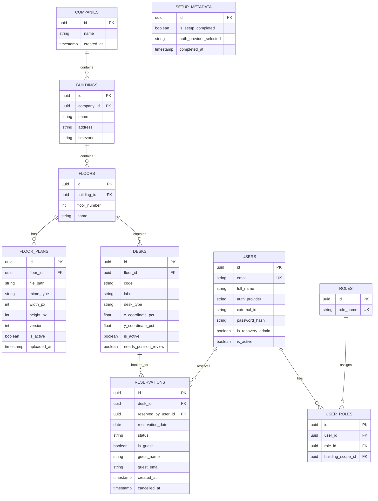
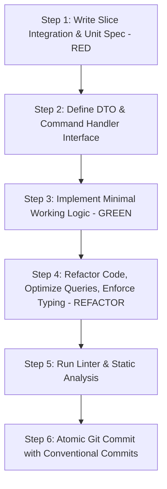

# Workplace Seat Reservation System — System Specification & Architecture Blueprint

> **Stage**: Specify (AI-DLC Phase 2)  
> **Status**: Approved for Scaffolding & TDD  
> **Baseline**: `docs/discovery/discovery_round_1.md` (v0.3 Decisions)

---

## 1. Executive Summary & Product Vision (PO / BA View)

The **Workplace Seat Reservation System** is a lightweight, responsive, single-tenant workplace management platform modeled after modern scheduling solutions like Skedda. It enables organizations to manage physical workplace layouts, upload floor plans, map desks via interactive click-to-place coordinates, and facilitate whole-day desk bookings for employees and visitors with strict race-condition prevention and role-based governance.

### Core Value Drivers
- **Frictionless Employee Self-Service**: Fast, visual floor-plan-based desk reservations with clear availability indicators.
- **Visitor & Guest Booking**: Seamless proxy reservations on behalf of external guests without requiring user provisioning.
- **Zero-Friction Administration**: Setup wizard with self-locking configuration and dedicated break-glass recovery administrator.
- **Enterprise Network Compatibility**: Designed for single-tenant internal corporate deployments behind Apache reverse proxy.

---

## 2. Business Requirements & User Stories (BA View)

### 2.1 Role Matrix & Permissions

| Capability | System Admin | Building Manager | Employee | Guest (Metadata) |
|---|:---:|:---:|:---:|:---:|
| Run First-Time Setup Wizard | ✅ (unlocked only) | ❌ | ❌ | ❌ |
| Break-Glass Recovery Login | ✅ | ❌ | ❌ | ❌ |
| Manage Buildings & Floors | ✅ | ✅ (assigned bldg) | ❌ | ❌ |
| Upload / Replace Floor Plans | ✅ | ✅ (assigned bldg) | ❌ | ❌ |
| Place Desks / Acknowledge Alignment | ✅ | ✅ (assigned bldg) | ❌ | ❌ |
| Reserve Desk for Self (Whole Day) | ✅ | ✅ | ✅ | ❌ |
| Reserve Desk for Guest (Proxy) | ✅ | ✅ | ✅ | ❌ |
| Cancel Own Reservation | ✅ | ✅ | ✅ | ❌ |
| Cancel Any Reservation | ✅ | ✅ (assigned bldg) | ❌ | ❌ |
| Assign User Roles & Building Scopes | ✅ | ❌ | ❌ | ❌ |

### 2.2 Core User Stories with Acceptance Criteria (Gherkin style)

#### US-1: First-Run Installation, Locking & Auth Provider Truthfulness
- **As a** DevOps / System Administrator  
- **I want to** initialize the application through a secured setup wizard  
- **So that** I can configure PostgreSQL connectivity, create the break-glass recovery admin, choose the authentication provider, and permanently lock setup.
- **Acceptance Criteria**:
  - *Given* a fresh deployment with no existing configuration, accessing `/setup` presents the step-by-step wizard.
  - *When* DB parameters are tested and valid, migrations run automatically. In production (`NODE_ENV=production`), explicit database passwords are required (no weak default fallbacks permitted).
  - *When* selecting an authentication provider, the UI and API truthfully reflect supported providers: `LOCAL` authentication is supported in v1.0. `OIDC (Corporate SSO)` is explicitly marked as "Not Configured" and disabled until an OIDC client provider is integrated.
  - *When* the recovery admin credentials and auth provider are committed, a `setup.lock` flag is persisted in both DB and configuration.
  - *Then* subsequent requests to `/setup` or setup endpoints return `403 Forbidden` / redirect to `/login`.

#### US-2: Visual Desk Placement & Replacement Flagging with Review Acknowledgment
- **As a** Building Manager or System Admin  
- **I want to** upload a floor plan image (PNG/JPG) and place desks interactively on an interactive canvas  
- **So that** employees can see an accurate representation of desk locations.
- **Acceptance Criteria**:
  - *Given* an uploaded floor plan image, clicking any coordinate `(x_pct, y_pct)` drops a desk marker with label and type.
  - *When* an existing floor plan image is replaced with an updated diagram, existing desk primary keys, coordinates, and active reservations are retained without data loss.
  - *When* replaced, desks are migrated to the new plan with `previous_floor_plan_id` recorded and `needs_position_review = TRUE`.
  - *Then* managers and admins can inspect flagged desks in the Desks management tab and acknowledge position review (`POST /workplace/desks/:id/acknowledge-review`).

#### US-3: Whole-Day Desk Reservation with Concurrency Control & Single Booking Constraint
- **As an** Employee  
- **I want to** select a floor, date, and available desk to reserve for myself or a guest  
- **So that** I have a guaranteed workspace on that date.
- **Acceptance Criteria**:
  - *Given* an available desk on date `YYYY-MM-DD`, confirming reservation creates a reservation record.
  - *When* two users concurrently attempt to book the exact same desk on the same date, exactly one succeeds and the other receives a `409 Conflict` response (`uq_active_desk_reservation_per_date`).
  - *When* the same user concurrently attempts multiple personal bookings for the same date, PostgreSQL atomic uniqueness constraint (`uq_one_personal_reservation_per_user_date`) guarantees exactly one succeeds and concurrent duplicates receive a `409 Conflict` response.
  - *Then* guest proxy bookings (`is_guest = TRUE`) remain permitted across multiple desks by the same employee.

#### US-4: Guest Proxy Booking
- **As an** Employee  
- **I want to** book a desk on behalf of an external visitor by providing their name and optional email  
- **So that** my guest has a reserved seat without needing an Active Directory/SSO account.
- **Acceptance Criteria**:
  - *Given* an employee booking a desk, they can select "Book for Guest" and input Guest Full Name and optional Email.
  - *When* created, the reservation indicates `reserved_by = employee_id`, `is_guest = true`, `guest_name = "Jane Doe"`.
  - *Then* the guest record does not create a system user account.

#### US-5: Interactive Demo Sandbox & Safe Reset Boundary
- **As an** Evaluator, Stakeholder, or New Employee  
- **I want to** access a pre-seeded demo environment with a pre-configured floor plan and desks, alongside an interactive "How to Use" guided walkthrough  
- **So that** I can immediately experience and test reserving seats, proxy guest bookings, and floor plan navigation without manual setup.
- **Acceptance Criteria**:
  - *Given* the application is running, a prominent "How to Use / Demo Tour" entry point is available in the UI.
  - *When* activated, a guided step-by-step interactive tour highlights key navigation and booking steps.
  - *Then* demo entities are explicitly flagged with `is_demo = TRUE` (belonging to Acme Tech HQ).
  - *When* resetting demo data, only records flagged with `is_demo = TRUE` are affected; ordinary company data, custom buildings, and live user reservations are strictly preserved.
  - *When* the system setup is locked, demo reset requests require authenticated `SYSTEM_ADMIN` authorization; unauthorized or unauthenticated requests return `403 Forbidden`.

#### US-6: Building-Scoped Permissions & Role Management
- **As a** System Admin  
- **I want to** assign roles and building scopes to users via a dedicated administration workflow  
- **So that** Building Managers are restricted strictly to managing floors, plans, desks, and cancellations within their assigned buildings.
- **Acceptance Criteria**:
  - *Given* a `BUILDING_MANAGER` user, API endpoints for floor creation, floor deletion, plan upload/replacement, desk placement, review acknowledgment, and administrative cancellation enforce `building_scope_ids`. Actions outside assigned buildings return `403 Forbidden`.
  - *Given* an authenticated `SYSTEM_ADMIN`, access is organization-wide and unconstrained by building scopes.
  - *When* an administrator modifies roles via `PUT /auth/users/:userId/roles`, the system verifies user IDs and building UUIDs, and prevents stripping `SYSTEM_ADMIN` privileges from the break-glass recovery administrator.

---

## 3. Architecture Blueprint: Autonomous Vertical Slices (Architect View)

To ensure high cohesion, low coupling, and rapid testability, the system avoids traditional anemic layered architecture ("all controllers in one folder, all services in another"). Instead, it is partitioned into **autonomous vertical slices**.

```
apps/api/src/
├── app.module.ts
├── common/                     # Cross-cutting primitives (Result<T>, Guard base, Logger)
└── slices/
    ├── system-setup/           # Slice 1: Installation, DB health, setup locking
    ├── identity-access/        # Slice 2: Auth providers, Recovery Admin, JWT, RBAC
    ├── workplace-management/   # Slice 3: Company, Buildings, Floors, Floor Plans, Desks
    ├── reservation-engine/     # Slice 4: Desk booking, Concurrency guard, Guest proxy
    ├── audit-logging/          # Slice 5: Domain event subscriber, Immutable audit trail
    └── demo-sandbox/           # Slice 6: Pre-seeded floorplan/desks demo data & sandbox reset
```

### 3.1 Anatomy of a Vertical Slice
Each vertical slice is an autonomous feature module with its own:
1. **API / Presentation**: Controllers, Request DTOs, Response DTOs with validation (`class-validator`).
2. **Commands & Queries (CQS)**: Distinct handlers for operations (e.g., `CreateReservationCommand`, `GetFloorAvailabilityQuery`).
3. **Domain Core**: Entities, Value Objects, Domain Invariants, Business Rules.
4. **Persistence & Infrastructure**: Repository / Data Mapper implementations using PostgreSQL & ORM/Query Builder.
5. **Contract / Events**: Public TypeScript interfaces or domain events exposed to other slices via NestJS EventEmitter (no direct inter-slice DB table querying).

```
slices/reservation-engine/
├── index.ts                     # Slice public contract & module definition
├── reservation.module.ts
├── api/
│   ├── reservation.controller.ts
│   ├── dto/
│   │   ├── create-reservation.dto.ts
│   │   └── reservation-query.dto.ts
├── commands/
│   ├── create-reservation.command.ts
│   ├── create-reservation.handler.ts
│   ├── cancel-reservation.command.ts
│   └── cancel-reservation.handler.ts
├── queries/
│   ├── get-floor-availability.query.ts
│   └── get-floor-availability.handler.ts
├── domain/
│   ├── reservation.entity.ts
│   ├── reservation-policy.spec.ts
│   └── events/
│       ├── reservation-created.event.ts
│       └── reservation-cancelled.event.ts
└── infrastructure/
    └── persistence/
        ├── reservation.repository.ts
        └── reservation.schema.ts
```

### 3.2 Inter-Slice Communication Matrix
- **Synchronous Cross-Slice Reads**: Slices export explicit typed read queries/services (e.g., `DeskAvailabilityChecker` interface).
- **Asynchronous Cross-Slice Reactions**: Handled via NestJS EventEmitter2 (`ReservationCreatedEvent` -> `AuditLoggingSlice`).
- **Data Boundary**: Slices own their tables. No foreign key joins across boundary boundaries in SQL queries unless resolved via aggregate repository or read-model projections.

---

## 4. Data Architecture & Relational Schema (Lead View)

PostgreSQL is the single source of truth. Integrity constraints are enforced at the database level to prevent race conditions.



### Critical Concurrency Protection
To guarantee zero double-bookings and ensure strict personal booking invariants under concurrent HTTP requests without slow table locks, PostgreSQL partial unique indices enforce invariants at the ACID storage engine level:

1. **Desk Double-Booking Prevention**:
```sql
CREATE UNIQUE INDEX uq_active_desk_reservation_per_date 
ON reservations (desk_id, reservation_date) 
WHERE status = 'CONFIRMED';
```
This partial unique index ensures PostgreSQL rejects any overlapping desk booking at the atomic commit level with error code `23505 (unique_violation)`.

2. **Single Personal Booking per User per Date**:
```sql
CREATE UNIQUE INDEX uq_one_personal_reservation_per_user_date
ON reservations (reserved_by_user_id, reservation_date)
WHERE status = 'CONFIRMED' AND is_guest = FALSE;
```
This partial unique index atomically prevents race conditions where simultaneous requests by the same user for the same date could book multiple distinct desks. The API intercepts constraint `uq_one_personal_reservation_per_user_date` and translates it to a `409 Conflict` HTTP response: *"You already have a confirmed personal reservation on this date"*. Guest proxy bookings (`is_guest = TRUE`) are excluded from this constraint.

### Database Credential Security
To prevent default development credentials (e.g. `seatsecret123`) from inadvertently leaking into production environments:
- When running in production (`NODE_ENV === 'production'`), the application requires an explicit, externally injected `DB_PASSWORD` and `JWT_SECRET` environment variables. If omitted, the connection pool and authentication services throw fatal configuration exceptions during initialization.
- In the initial setup wizard, the database password field and recovery admin master password default to empty strings to enforce explicit, strong credential creation (minimum 12 characters).

### Privacy & Scoped Access Policy
To prevent identity disclosure and maintain privacy:
- **Floor Availability**: When querying `/reservations/floor-availability`, ordinary `EMPLOYEE` users receive seat status (`RESERVED` or `AVAILABLE`) and `isReservedByCurrentUser`. Only `SYSTEM_ADMIN` and assigned `BUILDING_MANAGER` for that building (plus the reserver on their own booking) receive occupant identity in `bookedFor`.
- **Workplace Reads**: `BUILDING_MANAGER` reads are scoped strictly to assigned buildings across `listBuildings`, `listFloors`, and `listFloorPlans`.

### Immediate Token Invalidation on Role Changes
To guarantee immediate privilege revocation without waiting for JWT expiration:
- The `users` table tracks a `token_version INT NOT NULL DEFAULT 1`.
- When an administrator modifies user roles or building scopes via `PUT /auth/users/:userId/roles`, the `token_version` is atomically incremented.
- `JwtStrategy` validates the token version against the database on each authenticated request, immediately rejecting stale tokens.

### SVG & Floor Plan Upload Security Policy
- Maximum payload limit of 5MB is enforced for floor plan images.
- For vector graphics (`image/svg+xml`), active scripts (`<script>`), inline event handlers (`onload`, `onerror`), embedded frames, entity declarations (`<!ENTITY`), and `<foreignObject>` tags are rejected with `400 Bad Request`.

### Floor Plan Replacement & Review Standard
- Desks on a replaced floor plan are flagged with `needs_position_review = TRUE` and tied to the previous floor plan version.
- Desk review alignment is confirmed via canonical endpoint `POST /workplace/desks/:id/acknowledge-review` (with `POST /workplace/desks/:id/review-ack` maintained as backward-compatible alias). Managers can reposition flagged desks directly on the canvas via `PATCH /workplace/desks/:id/coordinates`.

---

## 5. Test-Driven Development (TDD) Strategy (Engineer View)

Every vertical slice adheres strictly to the **Red-Green-Refactor** cycle before UI or deployment scripts are developed.

### 5.1 Testing Pyramid for Vertical Slices
1. **Unit / Domain Tests (Fast, In-Memory)**:
   - Domain invariants (e.g. `cannot cancel past reservation`, `guest booking requires guest name`).
   - Command validation rules.
   - Target: >95% coverage on pure domain logic.
2. **Integration Slice Tests (Real PostgreSQL via Testcontainers or Dev DB)**:
   - Full slice execution: HTTP request -> DTO validation -> Command Handler -> Database execution.
   - Race condition tests (e.g., executing 10 concurrent booking promises for the same desk & date to assert exactly 1 succeeds and 9 fail with 409).
3. **End-to-End (E2E) API Contract Tests**:
   - Supertest against NestJS application instance verifying auth guards, setup lockouts, and error payloads.

### 5.2 TDD Flow Per Feature


---

## 6. Git & AI-DLC Workflow Strategy

### 6.1 Branching Model
- `main`: Production-ready, deployable codebase.
- `develop`: Integration branch for completed vertical slices.
- `feat/slice-<slice-name>`: Feature branch dedicated to an autonomous vertical slice (e.g., `feat/slice-reservation-engine`).

### 6.2 Commit Convention
Strict Conventional Commits format:
- `feat(setup): implement first-run system configuration and lock mechanism`
- `test(reservation): add concurrent booking conflict tests`
- `refactor(workplace): optimize floor plan desk coordinate projection`
- `fix(auth): enforce break-glass recovery admin bypass during SSO failure`

---

## 7. Phased Implementation Roadmap

| Phase | Milestone | Focus | Deliverables |
|---|---|---|---|
| **Phase 1** | Project Workspace & Scaffolding | Monorepo Structure & Tooling | NestJS API, Vue 3 SPA, PostgreSQL Docker Compose, Shared contracts package |
| **Phase 2** | Slice 1: System & Setup | Wizard & Installation Lock | First-run wizard, DB test runner, Recovery Admin creation, `/setup` lockout |
| **Phase 3** | Slice 2: Identity & Access | Auth & RBAC | JWT auth, Break-glass login, Role guards (`SystemAdmin`, `BuildingManager`, `Employee`) |
| **Phase 4** | Slice 3: Workplace Management | Floor Plans & Desks | File upload (PNG/JPG), Click-to-place coordinates, Desks CRUD, Plan replacement review |
| **Phase 5** | Slice 4: Reservation Engine | Booking Core & Concurrency | Whole-day booking, DB concurrency constraint, Self & Guest proxy booking, Calendar matrix |
| **Phase 6** | Slice 6: Demo Sandbox & Seeder | Realistic Demo Workplace | Bundled SVG/PNG floor plan asset, 12+ pre-mapped sample desks, demo seed/reset commands |
| **Phase 7** | Frontend UI & Interactive Tour | Vue 3 UI & "How to Use" Guide | Skedda-like interactive canvas, Floor picker, Booking modal, Guided Tour overlay |
| **Phase 8** | Production Packaging & Hardening | Linux & Apache Setup | Production build, Apache `.conf` reverse proxy sample, Systemd unit templates |


